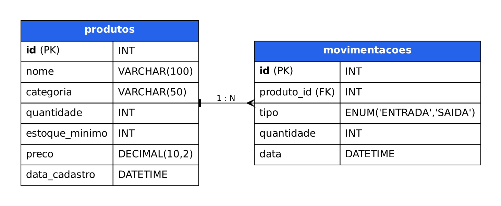

# Modelagem do Banco de Dados – SmartStock

## Relacionamento
Um **produto** pode ter várias **movimentações** (1:N). Cada movimentação pertence a um único produto, ligada pela chave estrangeira `produto_id`.

## Tabela `produtos`
| Campo | Tipo | Descrição |
|---|---|---|
| id | INT (PK) | Identificador do produto |
| nome | VARCHAR(100) | Nome do produto |
| categoria | VARCHAR(50) | Categoria do produto |
| quantidade | INT | Quantidade atual em estoque |
| estoque_minimo | INT | Quantidade mínima antes de gerar alerta |
| preco | DECIMAL(10,2) | Preço unitário |
| data_cadastro | DATETIME | Data de cadastro |

## Tabela `movimentacoes`
| Campo | Tipo | Descrição |
|---|---|---|
| id | INT (PK) | Identificador da movimentação |
| produto_id | INT (FK) | Produto movimentado |
| tipo | ENUM('ENTRADA','SAIDA') | Tipo da movimentação |
| quantidade | INT | Quantidade movimentada |
| data | DATETIME | Data da movimentação |

Script de criação: [`database/schema.sql`](../database/schema.sql)
