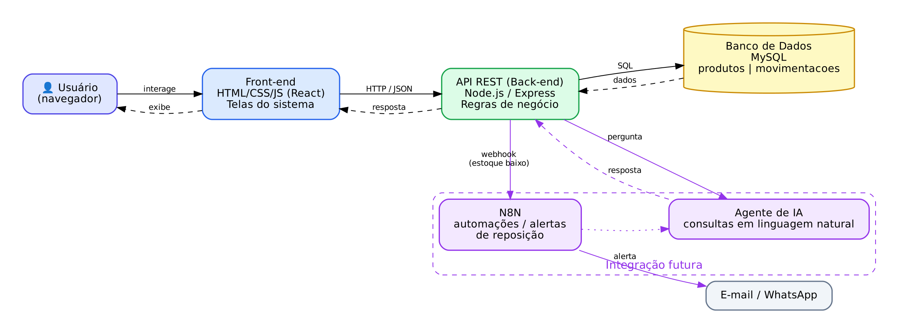

# Arquitetura da Solução – SmartStock

## Camadas
1. **Usuário** – acessa o sistema pelo navegador.
2. **Front-end** – interface web (HTML, CSS, JavaScript/React) com as telas de Login, Dashboard, Produtos, Movimentações, Relatórios e Configurações.
3. **API (Back-end)** – API REST (Node.js/Express) que recebe as requisições do front-end, aplica as regras de negócio (ex.: não permitir saída maior que o estoque, verificar estoque mínimo) e acessa o banco.
4. **Banco de Dados** – MySQL com as tabelas `produtos` e `movimentacoes`.

## Fluxo
Usuário → Front-end → (requisição HTTP/JSON) → API → (SQL) → Banco de Dados, e a resposta volta pelo mesmo caminho até a tela.

## Integração futura com IA e N8N
- **Agente de IA**: conectado à API. O usuário faz perguntas no front-end (ex.: "quais produtos estão acabando?"), a API envia a pergunta ao agente, que consulta os dados pela API e devolve a resposta.
- **N8N**: recebe eventos da API por webhook (ex.: produto abaixo do estoque mínimo) e executa automações, como enviar alertas de reposição por e-mail/WhatsApp e gerar relatórios agendados. O N8N também pode usar o agente de IA dentro dos fluxos.
